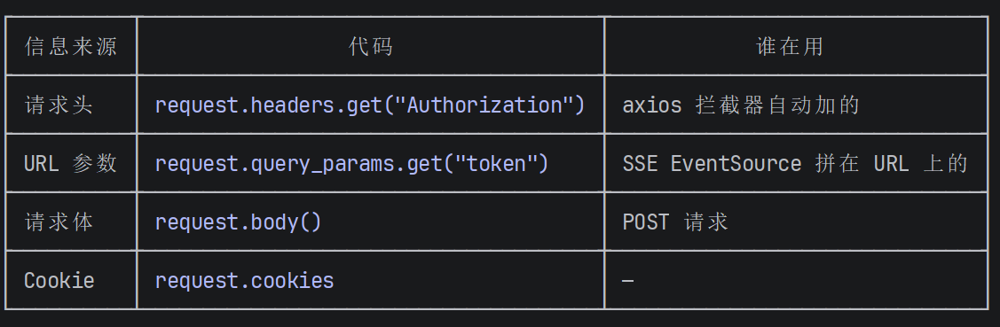
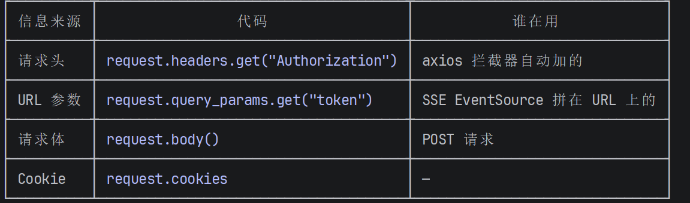

# 前后端联调问题修复总结

## 整体架构

```
前端 (Vue3 + ElementPlus, port 8080)
  │
  ├─ axios（普通请求）──→ Authorization: Bearer <token> ──→ 后端 FastAPI
  │                                                          │
  └─ EventSource（SSE）─→ URL?token=<token> ────────────────→ │
                                                             │
                                            后端 (FastAPI, port 8000)
                                              │
                                              ├─ /users/sendEmail ──→ 发送验证码
                                              ├─ /users/testCode  ──→ 验证验证码，返回 token
                                              ├─ /users/loginByPassword ──→ 密码登录，返回 token
                                              ├─ /chat/chat       ──→ SSE 流式聊天
                                              ├─ /chat/saveChat   ──→ 保存聊天记录
                                              ├─ /history/queryHistoryMenu ──→ 查询历史菜单
                                              ├─ /history/conversationLog  ──→ 查询对话详情
                                              ├─ /history/deleteHistory    ──→ 删除历史记录
                                              └─ /history/searchMessages   ──→ 搜索消息
```

---

## 问题一：登录后 `/history/queryHistoryMenu` 报 401

### 现象

```
GET http://localhost:8000/history/queryHistoryMenu?username=草草 401 (Unauthorized)
```

错误链路：`login.vue` → `setTimeout` → `chat.vue` → `onMounted` → `query_history_menu()`

### 原因

`login.vue` 的 `checkCode()` 函数中，**路由跳转发生在获取 token 之前**：

```javascript
// ❌ 修复前
function checkCode(){
    setTimeout(()=>{
        router.push("./chat")          // ① 同步跳转，token 还没拿到
        let checkCode = {...}
        proxy.$axios({                 // ② 异步调用验证码接口
            url:"users/testCode",
            ...
        }).then(res=>{
            sessionStorage.setItem("token", token)  // ③ token 在这里才保存（晚了！）
            router.push("./chat")                   // ④ 正确的跳转时机
        })
    }, 2000)
}
```

执行顺序：① 跳转到聊天页 → ② 聊天页 `onMounted` 触发 → ③ 请求 `/history/queryHistoryMenu` → ④ axios 拦截器读 `sessionStorage` 发现 token 为空 → ⑤ 请求头没有 `Authorization` → ⑥ 后端返回 401

### 修复

删除 `setTimeout` 中过早的 `router.push("./chat")`（第 430 行），只保留 `.then()` 回调中 token 存入之后的跳转：

```javascript
// ✅ 修复后
function checkCode(){
    setTimeout(()=>{
        // ❌ 删掉了：router.push("./chat")
        let checkCode = {...}
        proxy.$axios({
            url:"users/testCode",
            ...
        }).then(res=>{
            sessionStorage.setItem("token", token)   // ① 先存 token
            router.push("./chat")                    // ② 再跳转
        })
    }, 2000)
}
```

**涉及文件**：`rag_app/src/components/login.vue`

---

## 问题二：username 取不到，值为 undefined

### 现象

```javascript
let username = res.data.data.data  // undefined
sessionStorage.setItem("username", username)  // 存了个 undefined
```

### 原因

后端 `/users/testCode` 返回结构（`stu_fastapi/users/service/UsersService.py`）：

```python
return {
    "code": 200,
    "data": {
        "token": "...",
        "username": "草草"        # ← username 是 data 对象的一个属性，不是 data.data
    }
}
```

前端取值路径写错了：

```javascript
// ❌ res.data.data.data
// res.data = 整个响应体 { code, data }
// res.data.data = { token, username }
// res.data.data.data = undefined（不存在这个字段）

// ✅ res.data.data.username
// res.data = 整个响应体 { code, data }
// res.data.data = { token, username }
// res.data.data.username = "草草"
```

### 修复

`login.vue` 两处修改：

```javascript
// checkCode() 中
let username = res.data.data.username     // 原来是 res.data.data.data

// loginByPassword() 中
let username = res.data.data.username     // 原来是 res.data.data.data
```

**涉及文件**：`rag_app/src/components/login.vue`

---

## 问题三：SSE 聊天 `/chat/chat` 报 401

### 现象

```
GET http://localhost:8000/chat/chat?question=1&historyId=0&token=eyJ... 401 (Unauthorized)
```

axios 的普通请求正常，但 `EventSource`（SSE）请求 401。

### 原因

**前端**（`chat.vue`）使用 `EventSource` 发送 SSE 请求：

```javascript
// EventSource 不支持自定义请求头！只能把 token 拼在 URL 上
urlSearchParams.append("token", sessionStorage.getItem("token"));
let es = new EventSource('http://localhost:8000/chat/chat?' + urlSearchParams.toString());
```

**后端**（`JWTDecoder.py`）使用 `OAuth2PasswordBearer` 校验 token：

```python
# OAuth2PasswordBearer 只从 Authorization 请求头取 token！
oauth2_scheme = OAuth2PasswordBearer(tokenUrl="/testCode")
def get_current_user(token: Annotated[str, Depends(oauth2_scheme)]) -> dict:
```

两边取 token 的位置对不上：

| | token 放哪 | 后端能读到？ |
|---|---|---|
| axios 普通请求 | `Authorization: Bearer <token>` 请求头 | ✅ OAuth2PasswordBearer 能读到 |
| EventSource SSE | `?token=<token>` URL 参数 | ❌ OAuth2PasswordBearer 不看 URL |

### 核心概念：Request 对象

FastAPI 的 `Request` 是 Starlette 提供的请求上下文对象，封装了当前 HTTP 请求的全部信息：

```python
from fastapi import Request

def get_current_user(request: Request) -> dict:
    # 读请求头 → 适合 axios 请求
    request.headers.get("Authorization")

    # 读 URL 参数 → 适合 SSE 请求
    request.query_params.get("token")

    # 读请求体 → 适合 POST 请求
    request.body()

    # 读 Cookie
    request.cookies
```

### 修复

`JWTDecoder.py` 中 `get_current_user` 改为两级查找：

```python
# ✅ 修复后
from fastapi import Request

def get_current_user(request: Request) -> dict:
    token = None

    # 1. 先试请求头（axios 走这里）
    auth_header = request.headers.get("Authorization")
    if auth_header and auth_header.startswith("Bearer "):
        token = auth_header.replace("Bearer ", "")

    # 2. 没有再从 URL 取（SSE 走这里）
    if not token:
        token = request.query_params.get("token")

    # 3. 都没有 → 401
    if not token:
        raise HTTPException(status_code=401, detail="未提供token或token已过期")

    # 验证 token...
```

**核心思路**：

```
改之前：只能从 Authorization 请求头取 token → SSE 跪了
改之后：优先请求头，没有就查 URL（if-else 分两条路）→ 两种都兼容
```

**涉及文件**：`stu_fastapi/utils/JWTDecoder.py`

---

## 问题四：删除历史记录 CORS + 500 错误

### 现象

```
Access to XMLHttpRequest at 'http://localhost:8000/history/deleteHistory'
from origin 'http://localhost:8080' has been blocked by CORS policy

POST http://localhost:8000/history/deleteHistory 500 (Internal Server Error)
```

### 原因

`HistoryController.py` 中删除接口用的是 `has_roles` 依赖，不是 `get_current_user`：

```python
def delete_history(deleteHistory, user = Depends(has_roles(["admin"]))):
```

而 `has_roles`（`RolePermission.py`）内部是手动调用 `get_current_user` 的：

```python
# ❌ 修复前
def user_permission(authorization: str = Header(None)):
    token = authorization.split(" ")[1]       # 手动从 Header 取 token
    current_user = get_current_user(token)     # 把 token 字符串当参数传入
```

问题：
1. `get_current_user(token)` — 签名已从 `get_current_user(token: str)` 改为 `get_current_user(request: Request)`。现在传的是 JWT 字符串，被当成 `Request` 对象用，调用 `.headers` 就崩溃 → **500**
2. 500 崩溃后 CORS 中间件没正常执行 → 响应头没有 `Access-Control-Allow-Origin` → **CORS 报错只是表象**
3. `authorization = Header(None)` — 如果请求没带 Header，`None.split(" ")` 直接崩溃

### 修复方向

`RolePermission.py` 中 `has_roles` 也需要跟上 `get_current_user` 的签名变化，改为通过 `Request` 对象调用：

```python
# ✅ 修复后
def has_roles(*allowed_roles: list):
    def user_permission(request: Request):
        current_user = get_current_user(request)  # 传 Request，不是字符串
        if current_user['role_name'] in allowed_roles[0]:
            return current_user
        else:
            raise HTTPException(status_code=403, detail="无访问权限")
    return user_permission
```

**涉及文件**：`stu_fastapi/utils/RolePermission.py`（待修复）

---

## 关键文件清单

| 文件 | 改动内容 |
|---|---|
| `rag_app/src/components/login.vue` | ① 删除过早的路由跳转 ② `res.data.data.data` → `res.data.data.username` |
| `rag_app/src/main.js` | 未改（axios 拦截器、请求头配置保持不变） |
| `stu_fastapi/utils/JWTDecoder.py` | `get_current_user` 签名改为 `request: Request`，支持从请求头和 URL 取 token |
| `stu_fastapi/utils/RolePermission.py` | ⚠️ 待修复：`has_roles` 需要同步适配 `Request` 参数 |

---

## 经验总结

1. **登录流程中路由跳转必须放在 token 存储之后**，否则后续请求无 token 可用
2. **后端返回的 JSON 结构要对齐**：`res.data.data.username` 不是 `res.data.data.data`
3. **EventSource (SSE) 不支持自定义请求头**，token 只能拼 URL 上，后端需要从查询参数读取；`Request` 对象可以统一处理这两种来源
4. **CORS 报错不一定是 CORS 配置问题**：后端 500 崩溃也可能导致 CORS 头丢失
5. **改了函数签名要检查所有调用方**：`get_current_user` 改了签名，`RolePermission.py` 里直接调用它的代码也要同步改


Request 是什么？为什么要用它？

  Request 是 FastAPI（Starlette）提供的请求上下文对象，它把当前 HTTP 请求的所有信息都封装在一起：



  之前的 OAuth2PasswordBearer 只能从一个地方取 token（请求头），用了 Request 
  之后，我们可以手动从任意位置取 token。这就是为什么需要这个改动。

---
  还需修复：RolePermission.py

  删除接口 deleteHistory 还在报 500，因为它的权限校验 has_roles 内部直接调用了
  get_current_user(token字符串)，没跟上 get_current_user 签名的变化。需要改成通过 Request 对象调用
  get_current_user。要改吗？

✻ Churned for 12s

❯ 这个request我还是没搞明白。怎么想到用他的？是不是先来判断是用url方法还是axios方法有请求头的方法  

  Thought for 3s (ctrl+o to expand)

● 对，核心思路就是你说的这个——一个函数兼容两种 token 传递方式。
     
  思路推导

  第一步：发现问题

  普通 axios 请求（历史记录、删除等）正常，唯独 SSE 聊天请求报 401。对比一下：



  第二步：后端为什么收不到

  后端原先的写法：

  `oauth2_scheme = OAuth2PasswordBearer(tokenUrl="/testCode")`

  `def get_current_user(token = Depends(oauth2_scheme)) -> dict:`

  `OAuth2PasswordBearer` 是 FastAPI 自带的认证工具，它做的事情很单一：从 Authorization 请求头里把
  Bearer token 抠出来。URL 上的 ?token= 它根本不看。

  所以 SSE 请求到了后端，oauth2_scheme 在请求头里找不到东西，直接扔 401。

  第三步：怎么让它也能看 URL

  问题变成了——需要一个东西，能同时访问请求头和 URL 参数。FastAPI 里正好有 Request 对象，它把当前
  HTTP 请求的所有信息都装在一起了。

  改造思路就是你说的：

  def get_current_user(request: Request) -> dict:
      token = None

      # 先试请求头（axios 走这里）
      auth_header = request.headers.get("Authorization")
      if auth_header and auth_header.startswith("Bearer "):
          token = auth_header.replace("Bearer ", "")
    
      # 请求头没有，再试 URL 参数（SSE 走这里）
      if not token:
    
      # 两个都没有 → 401
      if not token:
          raise HTTPException(...)

  说白了就是加了一个 if-else 分支：优先看请求头，没有再看 URL。Request
  只是提供这两个数据来源的入口。

  第四步：为什么不用额外参数

  你可能会想：直接给 get_current_user 加个可选参数不就行了？

  def get_current_user(token = Depends(oauth2_scheme), url_token: str = None):

  不行，因为 FastAPI
  的依赖注入系统同一个函数不能同时从请求头和查询参数取同一个语义的值。OAuth2PasswordBearer 的
  Depends 已经把 token 来源锁死在请求头了。Request 跳过了这个限制，让我们手动控制从哪取。

  一句话总结

  ▎ 改之前：只能从请求头取 token（SSE 跪了）
  ▎ 改之后：优先请求头，没有就查 URL（两种都兼容）