# 智能健康管家 —— 完整流程与答辩速查

> 适用：多智能体（LangGraph Supervisor）+ 四层记忆 + RAG + Celery 定时巡检 + MCP 工具
> 图中 Mermaid 语法可在 Typora / VS Code(Markdown Preview Mermaid Support) / GitHub 直接渲染；每张图下面都给了 ASCII 版兜底。

---

## 图 0　系统总览（分层架构）

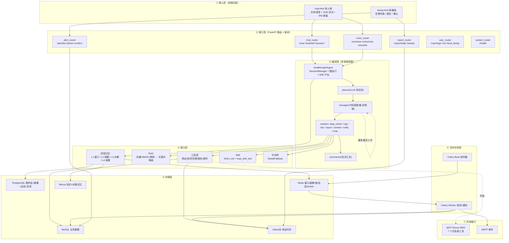

```
前端 ──► FastAPI 路由(鉴权/校验) ──► HealthGraphAgent ──► 多智能体图
                                              │              │
                                              │        planner(LLM) → manager(代码) → workers → summarize
                                              │              │
                                              ▼              ▼
                                         四层记忆      工具/DAO/Skill/中间件
                                              │              │
                                    Redis/PG/Milvus    MySQL/InfluxDB
                     Celery Beat ──► Redis broker ──► Celery Worker(检测+邮件)
```

---

## 图 1　启动流程（`app/main.py` lifespan）

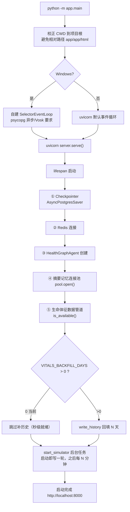

**依赖降级原则**：任一步失败只记日志、不阻塞启动（Redis/Milvus/Influx/MCP 都如此）。

---

## 图 2　一次文本对话（端到端，SSE）

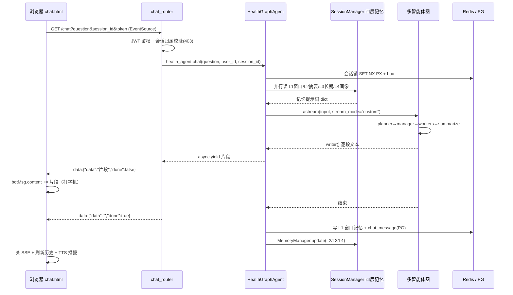

**要点**：`stream_mode="custom"` 只推 `chat/report/summarize` 三个节点主动 `writer()` 的内容；其它 7 个节点对前端静默。

---

## 图 3　图内多智能体编排（Supervisor 模式）

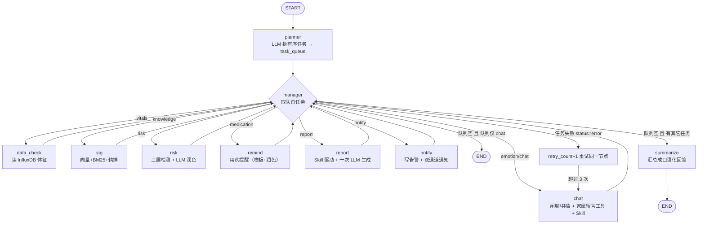

**关键设计（答辩常问）**
| 问题 | 答案 |
|---|---|
| 谁是调度者？ | `manager_node`（纯代码路由，读 `task_queue`），不用 LLM → 可解释、可控、零 token |
| worker 之间怎么通信？ | 共享 `HealthState`（黑板模式），每条 worker 出边回 manager |
| 失败怎么处理？ | 节点写 `status="error"` → manager 重试 ≤3 次 → 超限**降级到 chat**（澄清话术） |
| 为什么只有 manager 用 Command(goto)？ | 统一收口，便于重试/降级/审计；其它节点用静态边回 manager |

---

## 图 4　定时巡检与告警通知（Celery，**你现在跑的这条**）

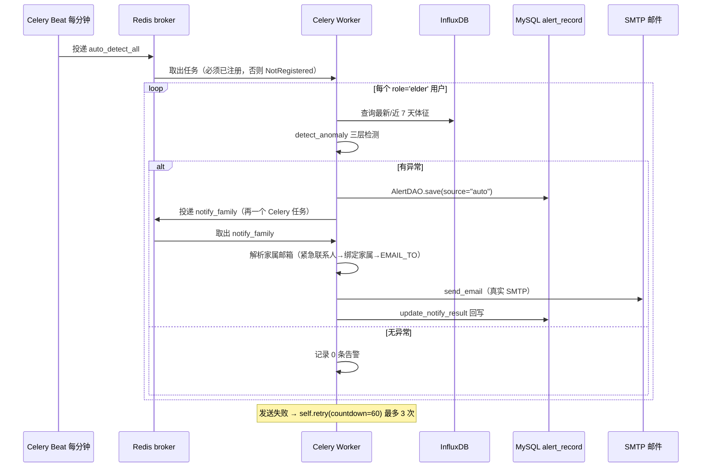

**三层检测**（`detect_anomaly`）
| 层 | 判据 | 等级 | 依赖 |
|---|---|---|---|
| 规则层 | 与 `.env` 阈值比较（HR>120、SBP>180、SpO₂<90…） | **高危** | 只要"最新一条" |
| 趋势层 | 当前值偏离 7 天基线 >30% | 中危 | 需要多天历史 |
| 离群层 | 个体 MAD >3 倍 / STD >2 倍 | 中危 | 需要 ≥5 个点 |

---

## 图 5　对话触发告警（老人自述不舒服 → 双通道）

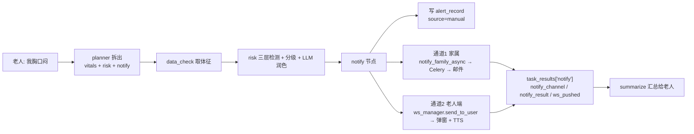

---

## 图 6　四层记忆（读取 / 写入）

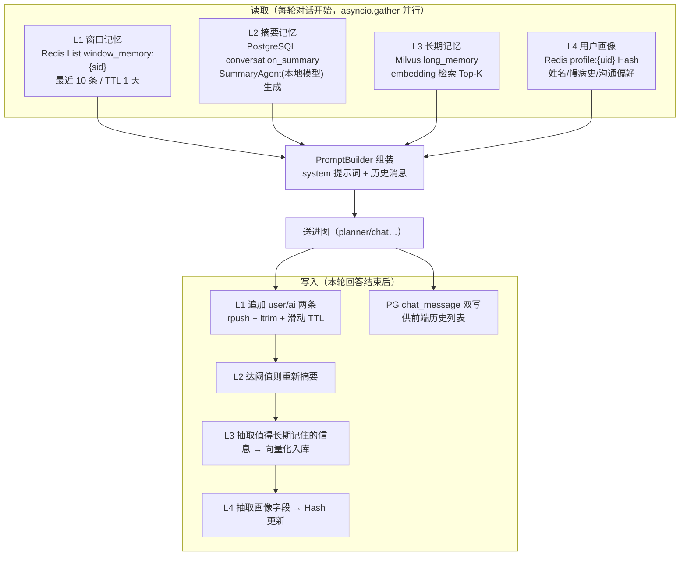

**降级**：L1 Redis 挂→进程内字典；L2 PG 挂→进程内字典；L3 Milvus 挂→Chroma→进程内；L4 Redis 挂→跳过。

---

## 图 7　Skill 的两条接入路径（都已跑通）

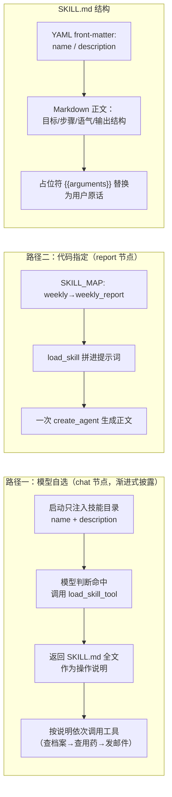

**新增技能不用改代码**：`app/skills/registry/<名字>/SKILL.md` 放进去即可（AC-22）。

---

## 图 8　工具与 MCP 的三级降级

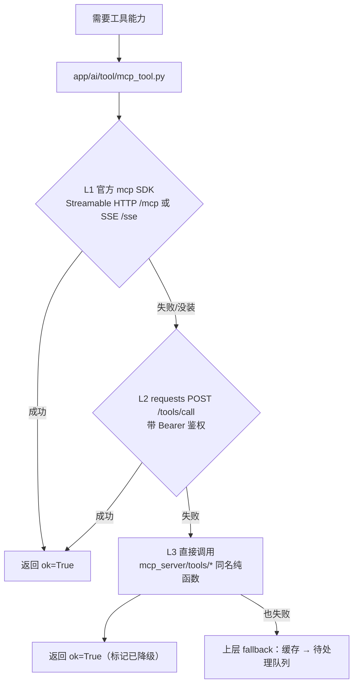

**MCP Server 两条路线**：① 官方 SDK `FastMCP`（mcp 1.x，SSE，9000）② mcp SDK 不可用时 **FastAPI 降级版**（`/healthz`、`/tools/list`、`/tools/call`）。
**7 个白名单工具**：get_user_profile、get_medication_schedule、get_vitals、search_knowledge、generate_report、send_sms、send_email。
**双层防护**：`Bearer MCP_API_KEY` + 工具白名单。

---

## 图 9　鉴权与数据权限

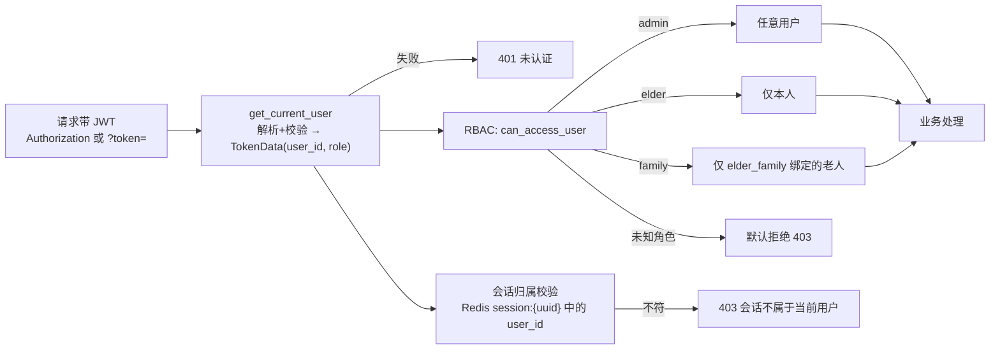

---

## 表 A　图状态关键字段（`HealthState`）

| 字段 | 作用 | 通道语义 |
|---|---|---|
| `messages` | 对话消息 | `operator.add`（累加） |
| `user_id` / `session_id` / `role` | 身份 | LastValue |
| `task_queue` / `current_task` | 任务队列与当前任务（参数载体） | LastValue |
| `task_results` | 各 worker 结果（`status`/`error`…） | 自定义 merge reducer + `{"__reset__":True}` 清空 |
| `retry_count` | 当前任务重试次数（>3 降级 chat） | LastValue |
| `vitals` / `knowledge` / `risk_level` / `risk_reasons` / `anomalies` | 数据与检测结果 | LastValue |
| `notify_channel` / `notify_result` / `need_human_confirm` | 通知留痕 | LastValue |
| `report_type` / `report_content` / `report_path` | 报告产物 | LastValue |
| `final_answer` / `health_step` | 最终回答 / 步骤标记 | LastValue |

> `health_step` 只写不读（不是路由游标）；真正的游标是 `task_queue` + `manager`。

---

## 表 B　存储清单（答辩被问"数据放哪"）

| 存储 | 存什么 | 关键 Key / 表 |
|---|---|---|
| MySQL | 用户、健康档案、用药、告警、知识文档、家属绑定 | `user` / `health_profile` / `elder_family` / `medication*` / `alert_record` / `knowledge_doc` |
| PostgreSQL | 图状态与检查点、摘要记忆、会话索引、对话历史 | `checkpoints*` / `conversation_summary` / `chat_session` / `chat_message` |
| Redis(db1) | L1 窗口记忆、L4 画像、会话归属、分布式锁、待发短信队列、Celery broker/backend | `window_memory:{sid}` / `profile:{uid}` / `session:{uuid}` / `lock:session:{sid}` / `pending_sms` / `celery` |
| Milvus | 健康知识向量、长期记忆 | `health_knowledge` / `long_memory` |
| InfluxDB | 生命体征时序 | `agent_db.vital_signs` |

---

## 表 C　服务与端口

| 组件 | 地址 | 说明 |
|---|---|---|
| 后端 API + 前端静态页 | http://localhost:8000 | `/docs` 可看接口 |
| MCP Server | http://localhost:9000 | 未启动时工具自动降级为本地函数 |
| MySQL / PG / Redis | 3306 / 5432 / 6379 | Redis 用 db1 |
| InfluxDB 3 Core | http://localhost:8181 | 数据库 `agent_db` |
| Milvus | 19530 | 需要 etcd + minio |
| Celery worker | 命令行进程 | `-A app.core.celery_app.celery_app worker -l info -P solo` |
| Celery beat | 命令行进程 | `-A app.core.celery_app.celery_app beat -l info`（每 1 分钟巡检） |

---

## 表 D　已知缺口 / 改进项（面试官爱问"不足在哪"，这样答很加分）

| # | 现状 | 影响 | 改进 |
|---|---|---|---|
| 1 | 定时巡检路径**不推老人端**（只有对话路径推 WS） | 定时发现异常时老人端不弹窗 | 照抄 `auto_detect_once` 的 WS 通道（~5 行） |
| 2 | 家属端 `family.html` 是**拉取式**（无 WS/轮询） | 家属要手动刷新 | 加 `setInterval(loadAlerts, 30000)` |
| 3 | `/ws/notify` **无 token 校验**（只按 `?user_id=`） | 可冒名订阅告警 | 校验 query 里的 JWT，失败 `close(1008)` |
| 4 | 人工确认后**不补发**（`/alert/{id}/confirm` 只改状态） | 人工确认不闭环 | confirm 后触发发送 |
| 5 | 短信通道已删除；MCP 的 `send_sms` 函数仍保留但不再调用 | — | 或彻底清理白名单/文档 |
| 6 | 关闭了启动补历史（`VITALS_BACKFILL_DAYS=0`） | 趋势/离群层短期缺历史窗口 | 临时改回 1 天（约 5~10 秒启动） |
| 7 | logger 只输出控制台、无文件日志 | 排查困难（如 NotRegistered 只能在窗口看到） | 加 `RotatingFileHandler` |
| 8 | 会话状态在单进程内存（`ws_manager`） | 多副本时推送失效 | Redis pub/sub 广播 |

---

## 图 10　JWT 登录与请求鉴权（时序图）

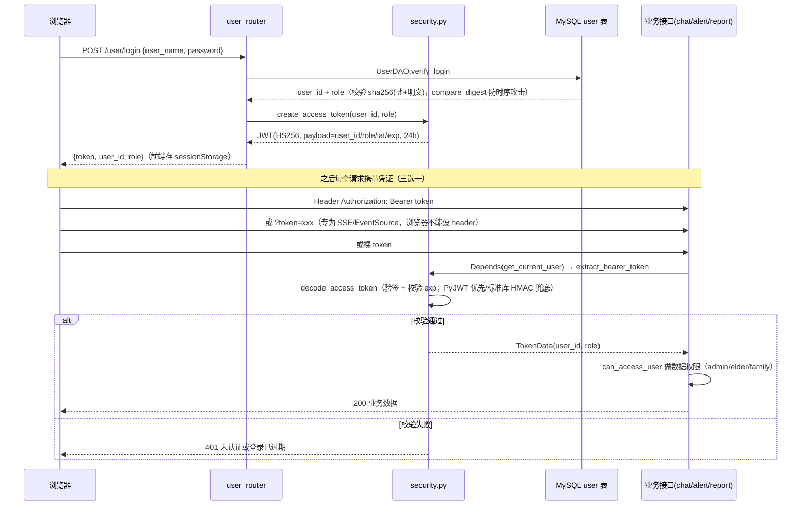

## 表 E　端点鉴权挂载实况（实测）

| 路由 | 端点数 | 已挂 `get_current_user` | 说明 |
|---|---|---|---|
| `chat_router` | 6 | **6 / 6** | 另做会话归属校验（越权 403） |
| `alert_router` | 3 | **3 / 3** | 再走 `_can_access`（列表/确认/检测都校验） |
| `report_router` | 3 | **3 / 3** | 再走 `can_access_user` |
| `user_router` | 4 | 2 / 4 | `/user/login`、`/user/register` 免鉴权；`/user/me`、`/user/bind_family` 有 |
| `voice_router` | 3 | 2 / 3 | `/voice/chat`、`/voice/tts` 有；**`/voice/ws` 没有** ⚠️ |
| `websocket_notify` | 1 | **0 / 1** | 只按 `?user_id=` 认人 ⚠️ |
| `system_router` | 1 | 0 / 1 | `/health` 免鉴权（探活需要，设计如此）✓ |
| `default_page_router` | 1 | 0 / 1 | `/` 静态页 ✓ |

**三层权限模型**
| 层 | 机制 | 代码 |
|---|---|---|
| 认证（你是谁） | JWT：HS256，payload=`user_id/role`，`exp=1440 分钟`；失败 401 | `security.create_access_token / decode_access_token` |
| 授权（你能看谁） | RBAC 数据权限：admin 任意 / elder 本人 / family 仅 `elder_family` 绑定 / **未知角色默认拒绝** | `security.can_access_user` + `UserDAO.list_bound_elders` |
| 资源归属（这个会话是不是你的） | 会话创建时把 `user_id` 存 Redis `session:{uuid}`，每次校验 | `HealthGraphAgent.check_session` → 403 |
| 工具级 | 邮件收件人白名单（只允许 `elder_family` 里的邮箱）；MCP `Bearer MCP_API_KEY` + 工具白名单 | `chat_node._make_mail_tool` / `mcp_health_server.KeyVerifier` |

## 表 F　鉴权已知缺口（老师若问"安全上还有什么不足"，主动说这些）

| # | 缺口 | 风险 | 改法 |
|---|---|---|---|
| 1 | `/voice/ws` 无任何校验（前端传了 `?token=` 但服务端不读） | 任何人可触发服务端麦克风识别 | 读 query token → `decode_access_token` → 失败 `close(1008)` |
| 2 | `/ws/notify` 只信 `?user_id=` | 可冒名订阅他人告警 | 校验 token，且用 token 里的 user_id 而非 query |
| 3 | 角色不在 `VALID_ROLES` 时被**静默降级为 elder** | 语义不严谨（不越权但应拒绝） | 解析时直接返回 None → 401 |
| 4 | `JWT_SECRET_KEY=health-butler-dev-secret`、口令哈希 `sha256(固定盐+明文)` | 教学级，生产不安全 | 换随机密钥 + bcrypt/argon2（加盐慢哈希） |
| 5 | `require_admin` 已实现但**未挂任何路由** | 管理端能力缺失 | 需要时挂上 |

## 附：答辩口述版（每条约 20 秒）

1. **整体**："前端分老人端和家属端；后端 FastAPI 只做鉴权、校验、协议适配；真正的编排在 LangGraph 多智能体图里：planner 用 LLM 拆任务，manager 用代码调度，7 个 worker 干活，summarize 汇总；四层记忆给模型提供上下文，工具层负责取数和外部动作，Celery 负责定时巡检与异步通知。"
2. **多智能体**："这是 Supervisor 模式：manager 读 task_queue 派活、失败重试不超过 3 次、超限降级到 chat；worker 之间通过共享 state 通信（黑板模式），统一收口便于重试和审计。"
3. **记忆**："L1 Redis 窗口记最近 10 条原文；L2 PostgreSQL 摘要；L3 Milvus 长期记忆做向量检索；L4 Redis 画像存慢病史与沟通偏好。读取时四层并行 gather，写入在每轮回答结束后。任一层挂了都降级，不影响对话。"
4. **RAG**："向量召回 + BM25 混合 + RRF 融合 + CrossEncoder 精排，逐级降级到 MySQL 关键词，最差返回静态安全建议，并保留来源/版本/页码满足溯源要求。"
5. **定时告警**："Celery Beat 每分钟投递巡检任务，worker 遍历老人做三层检测，命中异常就写 alert_record 并通过 Celery 异步发邮件给家属，失败按 60 秒间隔重试 3 次。"
6. **通知**："对话触发时是双通道——家属走 Celery 异步邮件，老人端走 WebSocket 弹窗 + 语音播报；定时巡检目前只通知家属，这是我列出的改进项。"
7. **工具调用**："基于 function calling：`@tool` + Pydantic schema，`create_agent` 内部 bind_tools，模型返回 tool_calls 后由框架执行并回灌 ToolMessage。我做了收件人白名单、两阶段确认、失败如实回传，防幻觉。"
8. **Skill**："技能是 Markdown 写的 SOP（`.md` + YAML 元数据）。chat 节点用渐进式披露——只把技能目录给模型，命中后调 `load_skill_tool` 拉全文；report 节点由代码指定技能名。新增技能不用改代码。"
9. **降级设计**："可选依赖缺失不阻塞启动、告警不丢：模型三级降级（主→备→本地，用中间件实现）、RAG 四级降级、MCP 三级降级、Web 层 /health 输出 full/partial/readonly 模式。"
10. **不足**："定时路径不推老人端、家属端无实时刷新、两个 WebSocket 缺鉴权、确认后不补发、趋势层需要历史窗口——这些我已经定位并有明确改法。"

````
你的报告有**两条完全不同的路径**，前端只负责第 ② 条（第 ① 条在聊天页里）。

# 一、两条路径对比

| | **路径 A：对话里生成（走图 + 流式）** | **路径 B：家属页 report.html（HTTP 接口 + Word）** |
|---|---|---|
| 入口 | `chat.html` 里老人说"帮我生成健康周报" | 家属端 `report.html` 页面 |
| 后端 | `/chat`(SSE) → 图 → **`report_node`** | `GET /report/daily`、`/report/weekly`、`/report/download` |
| 生成 | **SKILL.md 规程 + 一次大模型调用** | **模板拼装**（DAO + InfluxDB + RAG 建议），优先调 MCP 报告工具 |
| 输出 | SSE 逐段推（打字机）+ 落盘 `app/html/reports/*.md` | JSON 返回 Markdown → 页面 `marked` 渲染；Word 走下载接口 |
| 用不用大模型 | ✅ 用 | ❌ 不用（接口要确定性、快） |

# 二、路径 B 的前端代码（`app/html/report.html`）

**① 页面引入 Markdown 渲染库**（L9-10、373）
```html
<script src="https://cdn.jsdelivr.net/npm/marked/marked.min.js"></script>
```
```js
marked.setOptions({ breaks: true, gfm: true, headerIds: false, mangle: false });
formatMessage(c) { try { return marked.parse(c); } catch (e) { ... } }   // → v-html 展示
```

**② 取报告**（`load()`，L481-510）：日报/周报切换按钮决定 `this.type`
```js
const url = '/report/' + this.type + '?user_id=' + encodeURIComponent(this.queryUserId);
this.authFetch(url)                         // = fetch + Authorization: Bearer <token>
    .then(res => res.json().then(b => ({ status: res.status, body: b })))
    .then(({status, body}) => {
        if (status !== 200) { ... if (status===403) this.content = '## ⛔ 无权查看…'; return; }
        const d = body.data !== undefined ? body.data : body;
        this.content = typeof d === 'string' ? d : (d.report_content || d.content || d.markdown || ...);
    });
```

**③ 下载 Word**（`download()`，L512-543）—— 前端**不生成 docx**，只是取后端给的文件流：
```js
const url = '/report/download?user_id=' + ... + '&type=' + this.type;
this.authFetch(url)
  .then(res => res.blob().then(blob => ({ blob, name: 从 Content-Disposition 解析 })))
  .then(({blob, name}) => {
      const href = URL.createObjectURL(blob);
      const a = document.createElement('a'); a.href = href; a.download = name;
      document.body.appendChild(a); a.click(); document.body.removeChild(a);
      setTimeout(() => URL.revokeObjectURL(href), 3000);
  });
```

# 三、路径 B 的后端代码（`app/web/report_router/report_router.py`）

```
GET /report/daily   →  _report(user_id, "daily",  days=1)
GET /report/weekly  →  _report(user_id, "weekly", days=7)
                          │
                          ├─① _check_access()      数据权限：家属只能查绑定老人 → 否则 403
                          └─② _generate_report_data()
                                ├─优先 mcp_server.tools.report_tool.generate_report（asyncio.to_thread）
                                └─降级 _build_basic_report()：DAO + InfluxDB 拼四章节 + RAG 建议
                          → 返回 {"code":200,"data":{"title","content","summary"}}   ← Markdown 文本
GET /report/download →  同鉴权 + 同生成
                          → _write_docx()  用 **python-docx** 写 Word
                          → 落盘 ./app/data/reports/健康报告_周报_u001.docx
                          → FileResponse 返回（带 Content-Disposition 文件名）
```
**四章节（AC-13）**：指标概览 / 异常汇总 / 用药依从性 / 个性化建议（建议来自 `rag_search_with_fallback`，失败有静态兜底）。
**安全细节**：`safe_user_id` 过滤 + `file_path.startswith(base_dir)` **防路径穿越**；python-docx 未装返回明确的 500 提示。

# 四、两条路径落盘位置不同（答辩别混）

| 路径 | 落盘文件 | 格式 |
|---|---|---|
| A 图内 `report_node` | `app/html/reports/{user_id}_{type}_{YYYYmmdd}.md` | Markdown（静态目录可直接访问） |
| B 接口 `/report/download` | `app/data/reports/健康报告_{日报\|周报}_{user_id}.docx` | Word（通过下载接口给用户） |

# 五、30 秒口述版

> "报告有两条路径：
> **① 对话里**——老人说'生成健康周报'，planner 拆出 report 任务，`report_node` 用 **SKILL.md 规程 + 一次大模型调用**生成正文，通过 `writer()` 走 SSE 流式推给前端，并落盘 Markdown；
> **② 家属页 `report.html`**——调用 `GET /report/weekly`（或 daily），后端先做数据权限校验，再优先调 MCP 报告工具、失败降级为 DAO+InfluxDB 拼装四章节（指标概览／异常汇总／用药依从性／个性化建议，建议来自 RAG 降级链），返回 Markdown 由前端 **marked.js** 渲染成页面；点'下载 Word' 时走 `GET /report/download`，后端用 **python-docx** 生成 `.docx` 落盘后以文件流返回，前端用 `blob` + `<a download>` 触发下载。"
````

